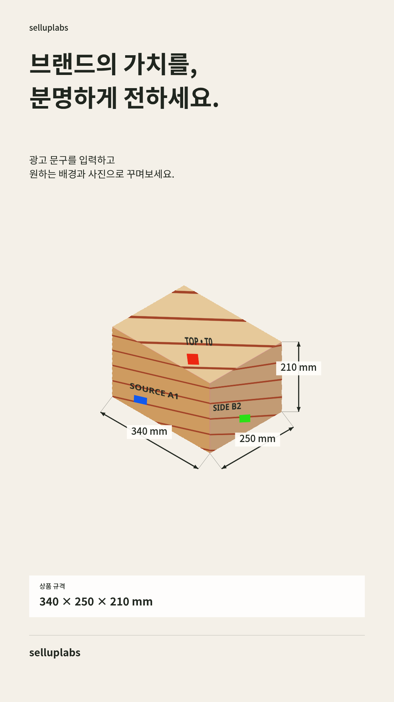
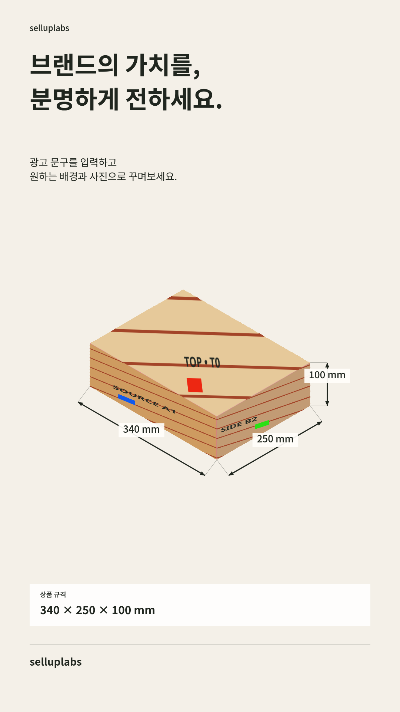

# 원본 사진의 면을 사용하는 규격 박스 시험판

2026-10-10 · 실제 상품 합격 전의 수동 보정 기능

## 구현한 범위

닫힌 직육면체의 윗면·앞면·오른쪽 면이 보이는 사진에서 사용자가 일곱 모서리를 지정한다. 세 면의 원본 화소를 원근 변환하여 입력한 가로·세로·높이로 계산한 직육면체에 배치한다. 치수선도 같은 형상의 해당 변에서 계산한다. 규격 변경·표시 숨김·문구 수정·PNG 저장에는 AI 호출이 없다.

원본 파일은 프로젝트에 그대로 보관한다. 결과 화소는 원근 변환과 보간을 거치므로 원본과 바이트 단위로 동일하지 않다. 휴대폰 메모리를 위해 샘플링용 사진만 긴 변 2048px로 제한한다. 모서리를 부정확하게 찍으면 배경이 가장자리에 남거나 인쇄가 잘릴 수 있다. 작은 글자와 QR의 선명도·인쇄 비례는 결과에서 별도 확인해야 한다.

기본값은 꺼짐이다. 일곱 점 지정과 현재 사진 확인 전에는 해당 모드의 PNG 출력·생성 요청을 차단한다. 사진을 교체하거나 모서리를 고치면 확인이 해제된다. 설정은 기기 저장과 JSON 백업에 포함된다. 서비스·규격 없는 상품·창작 모드에서는 적용하지 않는다.

## 직접 시험하기

1. 시험판 ZIP을 다운로드하고 압축을 푼 뒤 `aiadcast-box-test.html`을 PC Chrome에서 연다.
2. 빠른 동작 확인은 `파일 불러오기`로 동봉한 `synthetic-project.json`을 연다. 이 파일은 실제 상품이 아닌 시험용 무늬다. 영어 화면이면 상단 `한국어`를 선택한다.
3. 규격 탭에서 높이를 210에서 100으로 바꾸고 형상과 치수선이 함께 바뀌는지 확인한다.
4. 실제 우체국 3호 검증은 광고 정보에서 **조립된 박스 원본 사진**을 넣고, 규격을 340×250×210mm로 입력한다. 펼친 사진의 다른 인쇄를 섞지 않는다.
5. 규격 탭의 `규격 박스 구성 사용`을 켜고 안내된 일곱 모서리를 사진에서 지정한다. 필요하면 2배·4배로 확대하고 화살표로 원본 기준 1픽셀씩 이동하거나 X/Y 입력으로 미세 조정한 뒤 확인한다. 확대 중에는 같은 점을 계속 조정하며, 상단 번호로 다음 점을 고른다.
6. 원본과 출력에서 로고·글자·캐릭터·치수 축을 비교한다. `프로젝트 백업`으로 사진과 지정 정보를 함께 보관한다.

ZIP은 서버 없이 실행하는 편집 시험판이다. 이 배포본에는 유료 AI 연결 주소·키가 없으며 AI 생성, 고객 결제, 클라우드 저장을 제공하지 않는다. 다른 기기로 옮길 때는 JSON 백업을 사용한다. PNG만으로 편집 정보가 복원되지는 않는다.

## 검증과 남은 한계

- 전체 도메인 검사 141개, PC·모바일 브라우저 검사 94개 통과. 실제 Android 기기 검증과 구분한다.
- 합성 원본의 해시/바이트 보존, 면별 무늬 매핑, 규격 변경, 미확인 차단, 사진 교체 시 확인 해제, 저장/복원, 가로 넘침과 유료 호출 부재를 검사했다.
- 외곽 안티앨리어싱 화소가 원본 배경색을 끌어오는 문제를 줄이도록 경계 샘플을 제외했다. 정확히 보정한 합성 시험의 자홍색 배경 유출도 검사한다.
- 단일 HTML 배포본을 로컬 HTTP로 연 뒤 브라우저 네트워크를 끊고 프로젝트 불러오기·높이 변경·PNG 출력(171,327 bytes)을 확인했다. 이 개발 브라우저는 관리 정책으로 `file://` 접근을 차단하므로 PC 파일 직접 열기 검증은 별도로 남긴다.
- 입력 치수로 만든 형상의 계산은 검증했지만 **실물 우체국 박스의 동일성과 측정 규격 일치는 아직 합격 처리하지 않았다.** 채팅 인라인 사진의 원본 파일이 실행 공간에 연결되지 않아 자동 시험에는 사용하지 않았다.
- 자동 모서리 인식, 숨은 면, 곡면, 열린 상자, 전개도 조립, 실물 측정/촬영 보정은 지원하지 않는다. 실제 사진과 입력 치수가 다르면 인쇄가 늘어나므로 올바른 실물 치수와 축 확인이 필요하다.
- 이 기능은 출원서의 전체 구현·특허 적합성·기술보증기금 심사 통과를 의미하지 않는다. 고객이 원하는 간편한 흐름을 위해 자동 모서리 제안은 후속 개선 대상이다. 확대·미세 조정은 아래 후속 구현을 참고한다.

새 API 호출과 환경 설정 변경은 없었다.

## 다운로드와 비교 이미지

[PC 편집 시험판 ZIP](previews/aiadcast-box-test.zip) · GitHub 파일 화면의 다운로드 버튼으로 저장한다.

ZIP SHA-256: `68641d7bcfdc2703a32446d60557fe73246903e7d4ecb4ec0a9320aff7405f1e`

아래 두 이미지는 동일한 **합성 시험용 인쇄**로 높이만 바꾼 결과다. 실제 우체국 사진이 아니다.

| 340 × 250 × 210 mm | 340 × 250 × 100 mm |
| --- | --- |
|  |  |

## 휴대폰 모서리 확대·미세 조정 — 2026-10-10 후속

- 사진 1×·2×·4× 확대, 스크롤 이동, 선택 점으로 화면 이동, 원본 1픽셀 단위 상하좌우 조정과 지정 진행률을 제공한다. 확대는 원본·투영 설정·사용 확인을 변경하지 않는다. 확대 중에는 같은 점을 반복 조정할 수 있도록 자동 다음 점 이동을 멈춘다.
- 확대·스크롤 후에도 SVG 좌표 변환으로 사진 좌표를 저장한다. 위치를 바꾸면 확인을 해제하고 사진 교체 시 확대·선택을 초기화한다.
- TypeScript/웹/단일 HTML 빌드, 관련 기하·투영 도메인 10개와 PC/모바일 편집·규격 브라우저 32개 검사 통과. 원본 바이트 보존, 무료 편집/내보내기, 승인 상태, 실제 PNG와 확대 스크롤 좌표를 확인했다. API 서버 없이 편집 검사를 실행하여 상태 조회 연결 거절 로그는 있었으며 공급사 생성 호출은 실행하지 않았다.
- 동봉 ZIP을 최신 독립 HTML로 교체했다. 실제 우체국 사진 원본 파일 검증은 여전히 남아 있으며 합성 시험 통과로 실물 검증을 대신하지 않는다.

- Android debug APK 빌드·서명 검증 통과. 내장 웹 파일 127개와 최신 dist 바이트 일치 확인. lint 오류0·JavaScript 사용 경고1. Java 단위 검사 태스크는 UP-TO-DATE로 기존 결과를 재사용했고 새로 실행한 2개로 집계하지 않는다. 실기기 검증은 하지 않았다. 근거: `release/android/corner-edit-evidence.json`.
